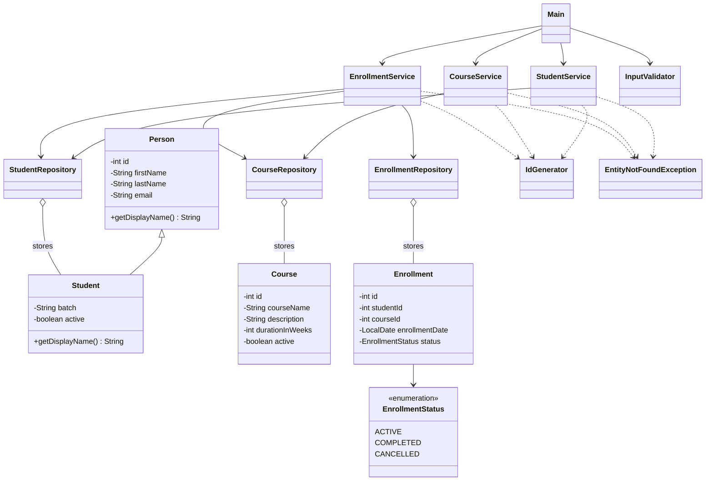

# LearnTrack

LearnTrack is a Core Java console application for managing students, courses, and enrollments. It uses object-oriented programming, `ArrayList` collections, basic exception handling, and an in-memory repository layer.

## Class Diagram



## Compile and Run

Use JDK 21 or a compatible later JDK. From the project directory, compile the Java source files.

PowerShell:

```powershell
New-Item -ItemType Directory -Force bin | Out-Null
$sources = Get-ChildItem -Recurse -Filter *.java src | ForEach-Object { $_.FullName }
javac -d bin $sources
```

macOS/Linux:

```sh
mkdir -p bin
javac -d bin $(find src -name '*.java')
```

Run the application from the project directory:

```sh
java -cp bin com.airtribe.learntrack.Main
```

## Documentation

- [Setup instructions](docs/Setup_Instructions.md)
- [JVM basics](docs/JVM_Basics.md)
- [Design notes](docs/Design_Notes.md)
